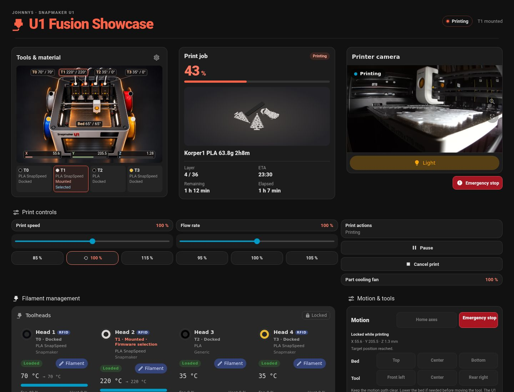
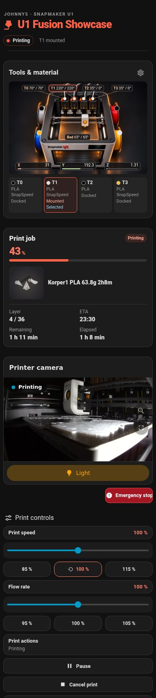

# 🖨️ Snapmaker U1 Community Hub
### Home Assistant Multi-Toolhead Dashboard & Tuned OrcaSlicer Profiles

**The complete, production-ready community toolkit for the 4-toolhead Snapmaker U1.**

[🌐 View Interactive Showcase Website](https://reaper2507.github.io/snapmaker-u1-homeassistant/) · [📖 Installation Guide](#-home-assistant-dashboard) · [⚡ OrcaSlicer Profiles](#-orcaslicer-profiles) · [☕ Support](#-support-this-project)

---

  
  

---

## ⚡ What's Inside

- **🎯 Interactive Multi-Toolhead Dashboard:** Live tracking for all 4 toolheads (T0–T3), nozzle temperatures, bed status, cutaway axis overlay, and camera streaming.
- **🛡️ 100% Local & Safe:** Moonraker-connected without cloud lock-in. Intelligent safety interlocks prevent axis movement during active printing.
- **🚀 Tuned OrcaSlicer Profiles:** Optimized for 0.4 mm and 0.6 mm stainless steel nozzles with gyroid infill, scarf seams, slim prime tower (12–15 mm³), and 12,000 mm/s² travel speed.
- **🧵 19 Calibrated Filament Presets:** Tested profiles for Bambu Lab, SUNLU PLA+ 2.0, eSUN PETG Matte, ELEGOO, and GEEETECH TPU.

---

## 📱 Home Assistant Dashboard

Get a complete 3-view dashboard (`Dashboard`, `Minimal`, `Maintenance & Diagnostics`) running in 3 minutes.

1. **Install HACS Frontend Cards:** `button-card`, `card-mod`, `slider-entity-row`, `vertical-stack-in-card`, `mini-graph-card`, `tabbed-card`, `fold-entity-row`.
2. **Copy Card Assets:** Place [`homeassistant/www/*`](homeassistant/www/) into your `/config/www/snapmaker-u1/showcase/` folder and register `/local/snapmaker-u1/showcase/u1-fusion-showcase.u1.js` as a Lovelace resource.
3. **Import YAML:** Paste [`homeassistant/u1_dashboard_complete.yaml`](homeassistant/u1_dashboard_complete.yaml) into your dashboard's Raw Configuration Editor.

<b>📖 Step-by-Step Home Assistant Setup & Control Package (Click to expand)</b>

### 1. Requirements
Ensure your Snapmaker U1 is connected via Moonraker or the [`ha-snapmaker-u1-card`](https://github.com/Ironoxx/ha-snapmaker-u1-card) integration.

### 2. Optional: Moonraker Direct Control Package
To enable direct homing, head parking, and jog movements with live state validation from Home Assistant:
- Copy [`homeassistant/packages/u1_control_package.yaml`](homeassistant/packages/u1_control_package.yaml) to your Home Assistant `/config/packages/` folder.
- Open the file and replace `YOUR_PRINTER_IP` with your printer's LAN IP address.
- Reload scripts and REST commands under **Developer Tools → YAML**.

### 3. Individual View Imports
If you don't want the full dashboard, you can import views individually:
- [`homeassistant/views/snapmaker-u1.yaml`](homeassistant/views/snapmaker-u1.yaml) — Main operator showcase.
- [`homeassistant/views/u1-minimal.yaml`](homeassistant/views/u1-minimal.yaml) — Clean, lightweight view.
- [`homeassistant/views/u1-maintenance.yaml`](homeassistant/views/u1-maintenance.yaml) — Diagnostics, bed mesh & G-code console.

---

## 🔪 OrcaSlicer Profiles

Drop-in profiles for OrcaSlicer (v2.5.0 RC and newer) tailored to the U1 toolchanger mechanism.

| Profile Name | Nozzle | Layer Height | Key Highlights |
|---|---|---|---|
| **0.20 Antigravity Optimized** | 0.4 mm | 0.20 mm | Daily reference. 3 walls, gyroid infill, slim prime tower (12–15 mm³), conditional scarf seam, 12,000 mm/s² travel. |
| **0.28 Antigravity Prototype** | 0.4 mm | 0.28 mm | Ultra-fast functional tests. 2 walls, 10% support cubic infill (-50% material). |
| **0.30 Antigravity Optimized** | 0.6 mm | 0.30 mm | High strength workhorse. Arachne wall generator, 1.2 mm solid ceiling. |
| **0.24 Antigravity Optimized** | 0.6 mm | 0.24 mm | Fine quality alternative for 0.6 mm nozzles. |
| **0.40 Antigravity Prototype** | 0.6 mm | 0.40 mm | Turbo throughput profile for oversized test prints. |

<b>📂 Profile Installation & 19 Filament Presets (Click to expand)</b>

### How to Install
Copy the [`orcaslicer/`](orcaslicer/) folders (`machine/`, `process/`, `filament/`) into your OrcaSlicer user directory:
- **Windows:** `%APPDATA%\OrcaSlicer\user\default\`
- **macOS:** `~/Library/Application Support/OrcaSlicer/user/default/`
- **Linux:** `~/.config/OrcaSlicer/user/default/`

### 19 Tuned Filament Presets Included
- **Bambu Lab:** PLA Basic (Black, Jade-White), PETG Basic (White).
- **SUNLU:** PLA+ 2.0 (Black, White, Bone-White, Little Blue, Olive Green, Sunny Orange).
- **eSUN:** PETG Matte (Apricot, Concrete Grey, Blue Brick, Dark Grey).
- **ELEGOO:** PLA Matte (Beige), PETG-CF (Black, Dark Grey — requires hardened nozzle!).
- **GEEETECH:** PLA Matte (Grey), TPU 95A (Transparent-Silver).

---

## ☕ Support this Project

This project is 100% free, independent, and open-source. If this dashboard or the profiles save you time, filament, or failed prints:

*If you share, feature, or fork this project, keeping the coffee link would be greatly appreciated, but is entirely optional!*

---

## 🤝 Contributing

Community feedback and improvements are welcome!
- To submit print feedback or suggest filament profile tweaks, please open an [Issue using our profile template](https://github.com/Reaper2507/snapmaker-u1-homeassistant/issues/new?template=profile-feedback.yml).
- Pull requests for dashboard improvements, mobile tweaks, or translations are happily reviewed.

See [CONTRIBUTING.md](CONTRIBUTING.md) for details.

---

## 📜 Credits & Acknowledgements

This project builds upon great work from the Home Assistant and 3D printing community:
- **[Ironoxx (ha-snapmaker-u1-card)](https://github.com/Ironoxx/ha-snapmaker-u1-card):** Foundation for toolhead layout and camera streaming (MIT License).
- **Home Assistant Card Authors:** Special thanks to RomRider ([button-card](https://github.com/custom-cards/button-card)), thomasloven ([card-mod](https://github.com/thomasloven/lovelace-card-mod), [slider-entity-row](https://github.com/thomasloven/lovelace-slider-entity-row)), ofekashern ([vertical-stack-in-card](https://github.com/ofekashern/vertical-stack-in-card)), and kalkih ([mini-graph-card](https://github.com/kalkih/mini-graph-card)).
- **[OrcaSlicer Team](https://github.com/OrcaSlicer/OrcaSlicer) & [Klipper](https://www.klipper3d.org/):** For premier open-source slicing and toolchanger control.

---

## ⚖️ License

Released under the [MIT License](LICENSE).
