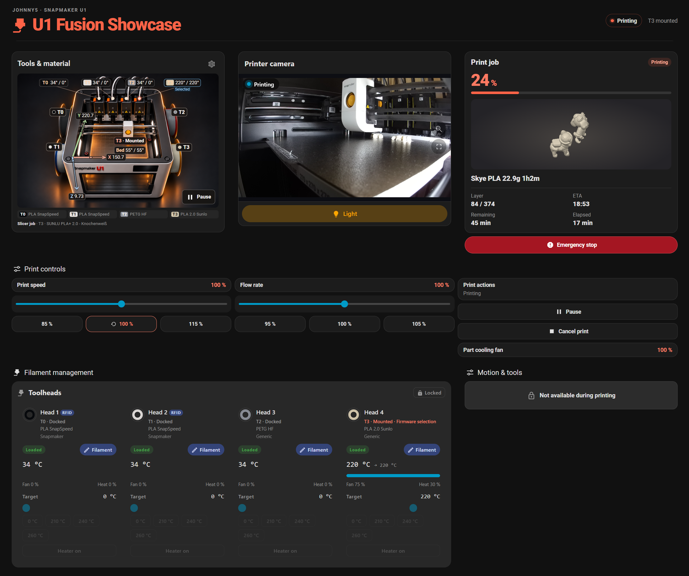
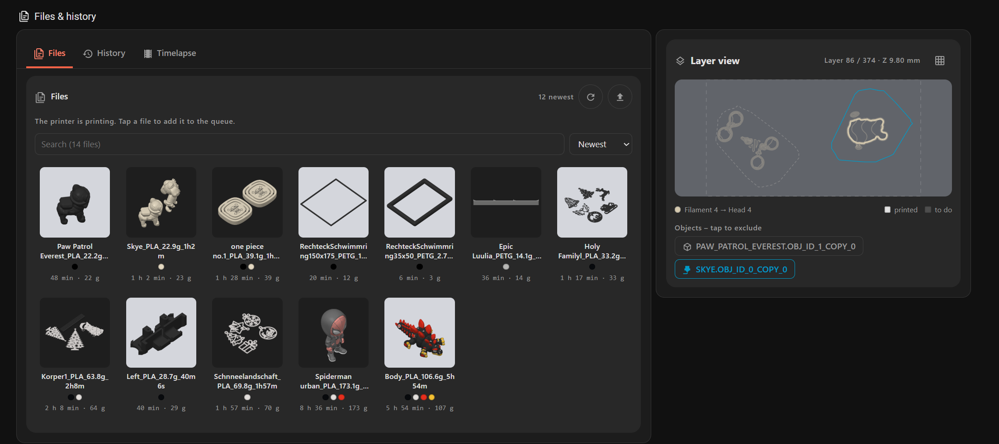
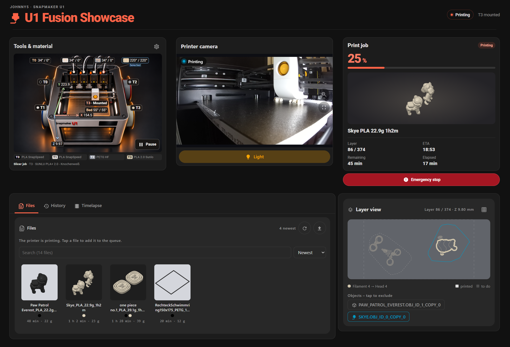
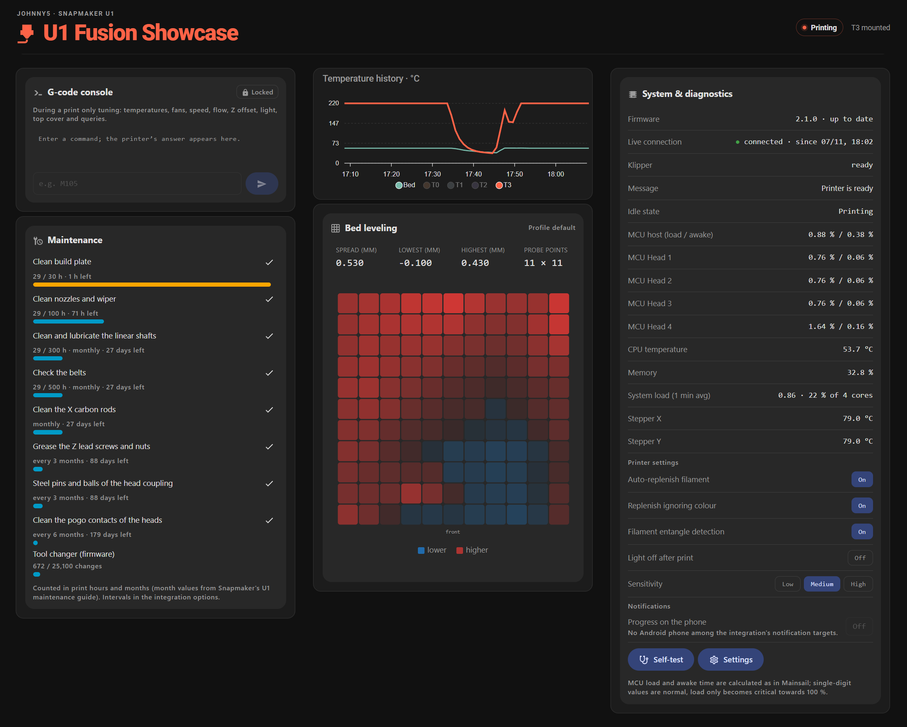
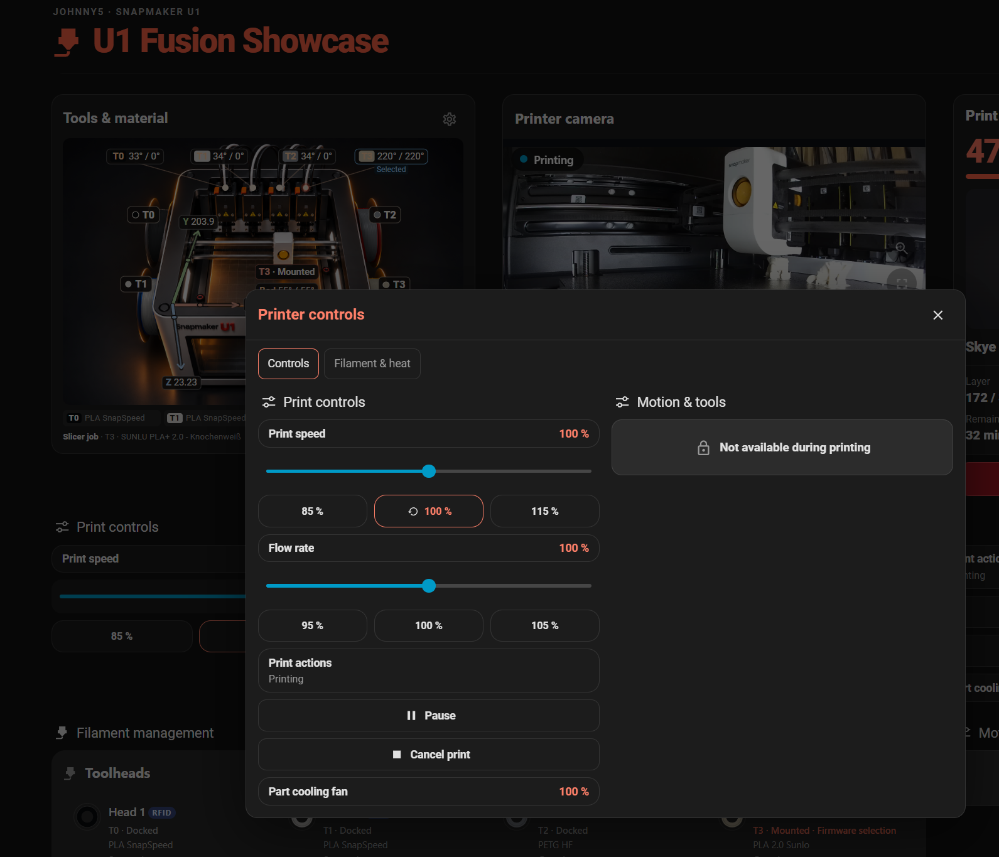
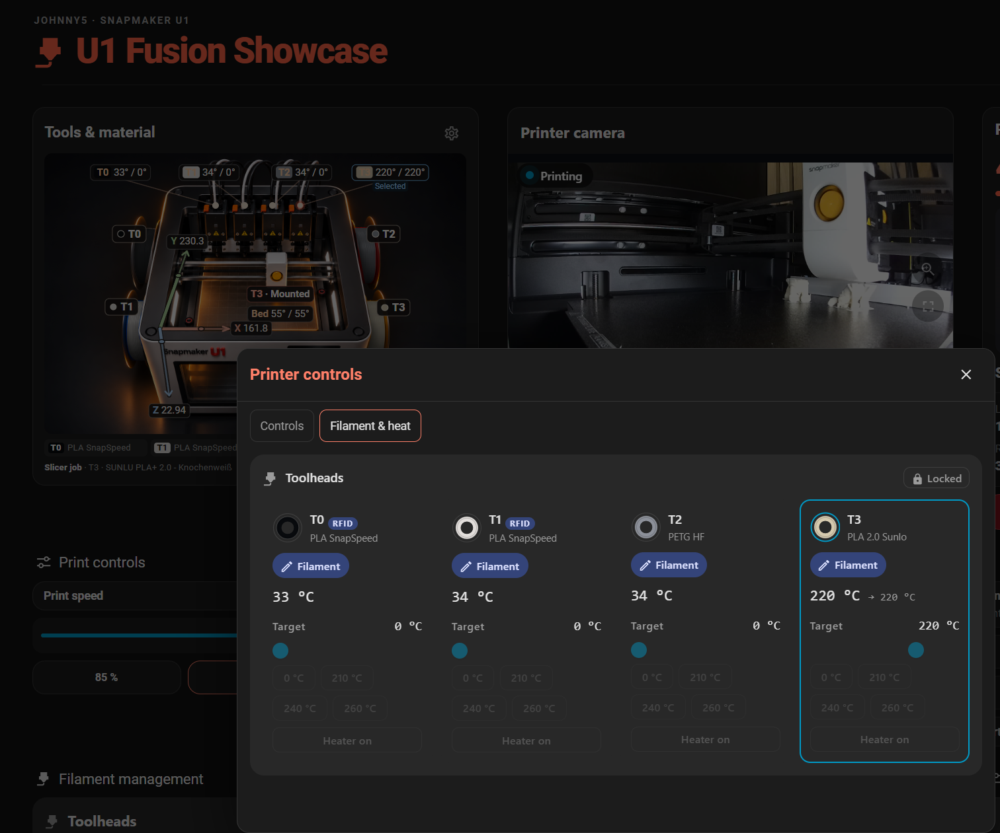
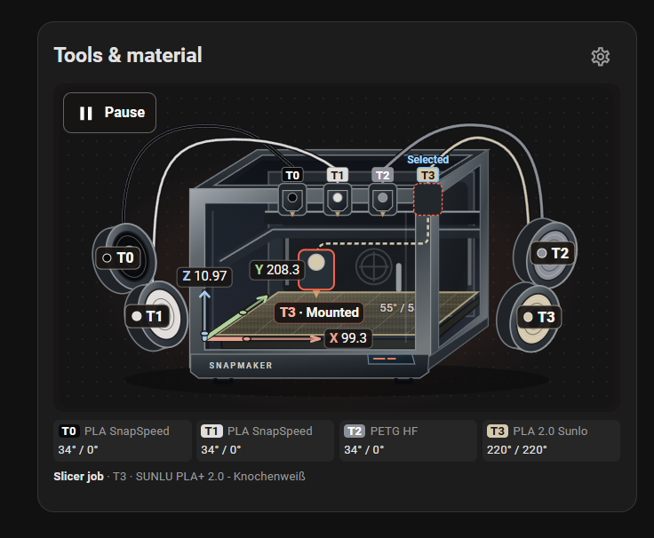

# Snapmaker U1 Dashboard for Home Assistant

A community dashboard by [Reaper2507](https://github.com/Reaper2507) for the Snapmaker U1.

## Built on Ironoxx’s Snapmaker U1 Card

[Ironoxx’s Snapmaker U1 Card](https://github.com/Ironoxx/ha-snapmaker-u1-card) provides the Home Assistant integration and the original printer card, including the layer view and object exclusion. The frontend bundled here is adapted from [Ironoxx’s v2.0.0 release](https://github.com/Ironoxx/ha-snapmaker-u1-card/tree/v2.0.0) and retains the [original copyright notice and MIT license](https://github.com/Ironoxx/ha-snapmaker-u1-card/blob/v2.0.0/LICENSE).

I built the Full, Minimal and Maintenance Lovelace views around that foundation. I also added the Studio and Cutaway visuals and made the printer graphic a shortcut to the dashboard’s controls.

[Dashboard views](#dashboard-views) · [Features](#features) · [Install the dashboard](#installation) · [Feedback & Ko-fi](#feedback-and-support)

## Dashboard views

[Full dashboard](#full-dashboard) · [Minimal](#minimal) · [Maintenance & diagnostics](#maintenance--diagnostics)

### Full dashboard

The upper section shows the Studio printer graphic, live camera and print progress, with speed, flow and filament controls below.

Further down, the same view shows the print files, history, timelapses and the current layer. Ironoxx’s [object exclusion in the layer view](https://github.com/Ironoxx/ha-snapmaker-u1-card/blob/3a76d19e3a7ac33bf9e5f730ebdaf2558d186e44/CHANGELOG.md#L682) lets you skip an individual object while the rest of the print continues.

### Minimal

A compact view of the printer, camera, job progress and estimated finish time, with recent files and the current layer below.

### Maintenance & diagnostics

Maintenance intervals, temperature history, an 11 × 11 bed mesh, the G-code console and system diagnostics in one view.

[More screenshots, including Cutaway and mobile](https://reaper2507.github.io/snapmaker-u1-homeassistant/homeassistant.html#showcase)

## Features

- **See what’s loaded.** The printer graphic shows the loaded filament color at each of the four spool positions (T0–T3), along with the mounted toolhead, live XYZ position and current and target nozzle and bed temperatures.
- **Control the printer from the graphic.** Tap it to open printer controls. With the [optional control package](homeassistant/README.md#optional-controls-and-notifications), you can mount or dock a toolhead and load or unload filament when the printer state permits. During a print, check progress and adjust speed and flow from the dashboard.
- **Follow the job and plan maintenance.** Check the camera, estimated finish time and current layer. The diagnostics view shows maintenance intervals, the bed mesh and temperature history.

### Tap the printer to open its controls

Select the printer illustration in **Tools & material** to open the control panel. **Controls** shows print speed, flow and job actions. **Filament & heat** shows the four toolheads, their loaded materials and their temperature targets. These screenshots were taken during a print, when movement, tool changes and heater controls are locked.

**Alternative Cutaway view**

## Installation

**1. Install Ironoxx’s integration.** Open the integration in HACS and restart Home Assistant after installation.

**2. Connect your Snapmaker U1.** Add the integration and enter the printer’s address.

**3. Install this dashboard.** Follow the [short installation page](https://reaper2507.github.io/snapmaker-u1-homeassistant/install.html) for the required Lovelace cards, assets and YAML import. The [repository guide](homeassistant/README.md) covers updates and troubleshooting.

## Optional extras

- **OrcaSlicer profiles.** [Install the U1 process presets](orcaslicer/README.md#install-the-presets) for everyday prints, faster drafts and compact multicolor jobs. [Browse 19 filament presets](orcaslicer/README.md#filament-presets) for matching spools, including SUNLU PLA+ 2.0 and eSUN PETG Matte.
- **Set & Send.** Thanks to LayerLab for bringing the U1’s pre-print setup to OrcaSlicer. Their add-on lets you match filaments to toolheads and choose U1 print options before sending a job. [LayerLab download and guide](https://layerlab.store/pages/set-and-send) · [Quick setup](orcaslicer/README.md#set--send-by-layerlab)
- **Helpful Home Assistant scripts.** [Optional printer controls](homeassistant/README.md#optional-controls-and-notifications) for tool changes and filament handling, plus a [microwave-style print completion ding and a brief chamber-light pulse](homeassistant/automations/README.md).
- [Filament handling and troubleshooting](GUIDE.md).

## Feedback and support

Tried the dashboard? [Share feedback](https://github.com/Reaper2507/snapmaker-u1-homeassistant/issues/new?title=Dashboard%20feedback%3A%20) about what worked, where setup was unclear or what you would like to see. For bugs, include the Home Assistant and integration versions, printer firmware and a redacted screenshot if it helps. See [contribution guidelines](CONTRIBUTING.md).

To support the dashboard and documentation by **Reaper2507**:

## Credits and license

1. [Ironoxx](https://github.com/Ironoxx/ha-snapmaker-u1-card) supplies the integration and original card. The adapted frontend retains the [original MIT license and copyright notice](https://github.com/Ironoxx/ha-snapmaker-u1-card/blob/v2.0.0/LICENSE).
2. [Donkie / Spoolman](https://github.com/Donkie/Spoolman) provides optional spool inventory through the integration. [Sponsor Spoolman](https://github.com/sponsors/Donkie).
3. [LayerLab](https://layerlab.store/pages/set-and-send) develops and distributes Set & Send separately.
4. [Thomas Lovén](https://github.com/thomasloven) provides card-mod and slider-entity-row. The [installation guide](homeassistant/README.md) links the other required cards.
5. [SoftFever and the OrcaSlicer team](https://github.com/OrcaSlicer/OrcaSlicer) maintain the slicer used by the optional presets.

Support **Ironoxx’s original integration**:

See [full credits](https://reaper2507.github.io/snapmaker-u1-homeassistant/credits.html) and the [MIT license](LICENSE). Third-party projects retain their own licenses.
