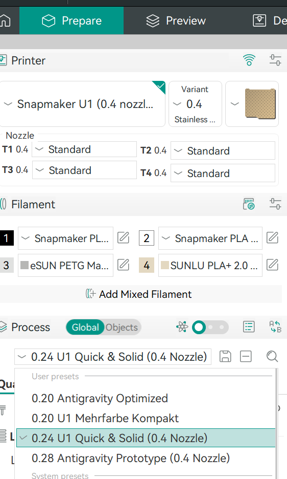

# OrcaSlicer presets for Snapmaker U1

These [OrcaSlicer 2.5](https://github.com/OrcaSlicer/OrcaSlicer/releases/tag/v2.5.0) presets cover print settings, matching filaments and optional LAN printer profiles. Use them as starting points for your U1.

---
## Process presets

| Nozzle | Preset | When to use it |
| --- | --- | --- |
| 0.4 mm | [0.20 Quality](process/0.20%20Quality%20%280.4%20Nozzle%29.json) | Decorative parts, smooth curves, visible surfaces (3 walls, 15% Crosshatch). |
| 0.4 mm | [0.20 Antigravity Optimized](process/0.20%20Antigravity%20Optimized.json) | Baseline reference profile (3 walls, Gyroid infill, Type-2 prime tower). |
| 0.4 mm | [0.24 Functional](process/0.24%20Functional%20%280.4%20Nozzle%29.json) | Load-bearing brackets, adapters, functional parts (3 walls, 15% Adaptive Cubic, 4 top layers). |
| 0.4 mm | [0.28 Fast](process/0.28%20Fast%20%280.4%20Nozzle%29.json) | Organizers, boxes, trays and household utility prints (2 walls with 0.48 mm inner line, 12% Adaptive Cubic). |
| 0.4 mm | [0.28 Prototype](process/0.28%20Prototype%20%280.4%20Nozzle%29.json) | Rapid fitment and dimensional check prints (2 walls, 10% Support Cubic, 2 bottom / 3 top layers). |
| 0.6 mm | [0.38 Functional](process/0.38%20Functional%20%280.6%20Nozzle%29.json) | High-strength mechanical parts with true 0.6 mm throughput (3 walls, 15% Adaptive Cubic). |
| 0.6 mm | [0.42 Fast](process/0.42%20Fast%20%280.6%20Nozzle%29.json) | Fast drafts and large-volume utility prints (2 walls, 10% Adaptive Cubic). |

Compare the time and material estimates in **Preview** after slicing your model. The result depends on the geometry, material, support and tool changes.

---
## Filament presets

[Download the 19 filament presets](filament/) for the 0.4 mm U1. Pick the preset for your actual spool and confirm its temperature and flow on a small print.

- **Bambu Lab:** PLA Basic (Black, Jade White), PETG Basic (White).
- **SUNLU:** PLA+ 2.0 (Black, White, Bone White, Little Blue, Olive Green, Sunny Orange).
- **eSUN:** PETG Matte (Apricot, Concrete Grey, Blue Brick, Dark Grey).
- **ELEGOO:** PLA Matte (Beige), PETG-CF (Black, Dark Grey). Use a suitable hardened nozzle for PETG-CF.
- **GEEETECH:** PLA Matte (Grey), TPU 95A (Transparent Silver).
- **Generic:** High Speed Matte PETG (Black), a starting point for an unidentified brand.

---
## Install the presets

1. In OrcaSlicer, enable the **Snapmaker U1** system printer for your nozzle size. Open **Help → Show Configuration Folder**, then close OrcaSlicer.
2. Back up your presets. [Download the repository ZIP](https://github.com/Reaper2507/snapmaker-u1-homeassistant/archive/refs/heads/main.zip) and extract it. Copy the JSON files from `orcaslicer/process/` and `orcaslicer/filament/` into the matching `process/` and `filament/` folders in your Orca user profile. The usual location is `user/default/` when signed out or the account folder under `user/` when using OrcaCloud. The optional stainless-steel LAN printer presets go into `machine/`. Preserve any presets you already customized.
3. Reopen OrcaSlicer and select the matching **Snapmaker U1** and nozzle in **Prepare**. Open the **Process** dropdown to find the entries under **User presets**, and use each toolhead’s **Filament** dropdown to assign its material. If a preset is missing, check its `inherits` and `compatible_printers` fields against the system printer and nozzle you enabled.

---

See the [OrcaSlicer guide to user profile folders](https://github.com/OrcaSlicer/OrcaSlicer/wiki/user_profiles) for platform and account details.

## Set & Send by LayerLab

Thanks to LayerLab for bringing the U1’s print setup to OrcaSlicer. Set & Send adds a pre-print dialog for filament-to-toolhead mapping and supported U1 job options. [Get Set & Send and follow LayerLab’s installation guide](https://layerlab.store/pages/set-and-send).

1. Select the U1 in OrcaSlicer. Use the network icon next to the printer to enter your U1’s local address.
2. On a plugin-capable OrcaSlicer build, subscribe to Set & Send and activate it in **Plugins**. In each process preset you want to use, enable Advanced or Expert mode and add **U1 print setup — Set & Send** under **Others → Slicing Pipeline Plugin**, then save the preset. Check the printer address when Orca asks for network access.
3. Slice, choose **Print**, then **Upload & Print**. Review the mapping and options in the Set & Send dialog. For builds without plugin support, LayerLab’s guide covers the separate Python post-processing script. Use one setup method per process preset.
